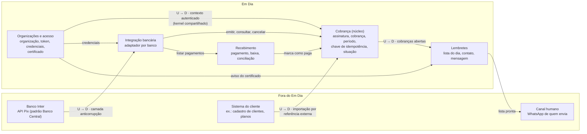
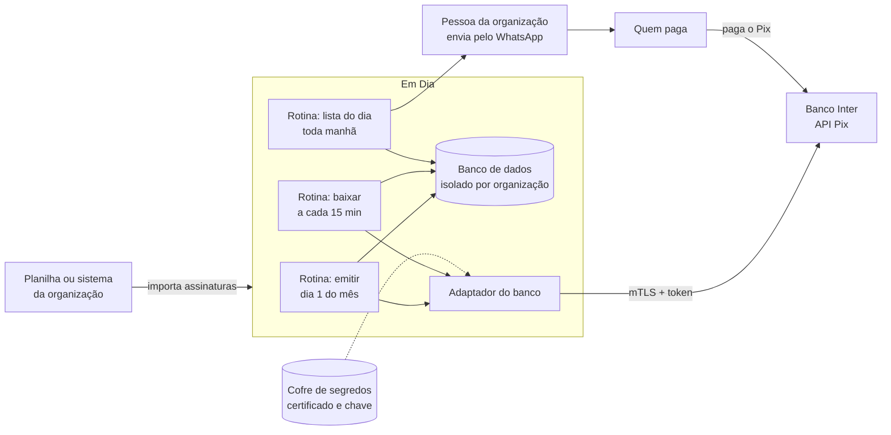
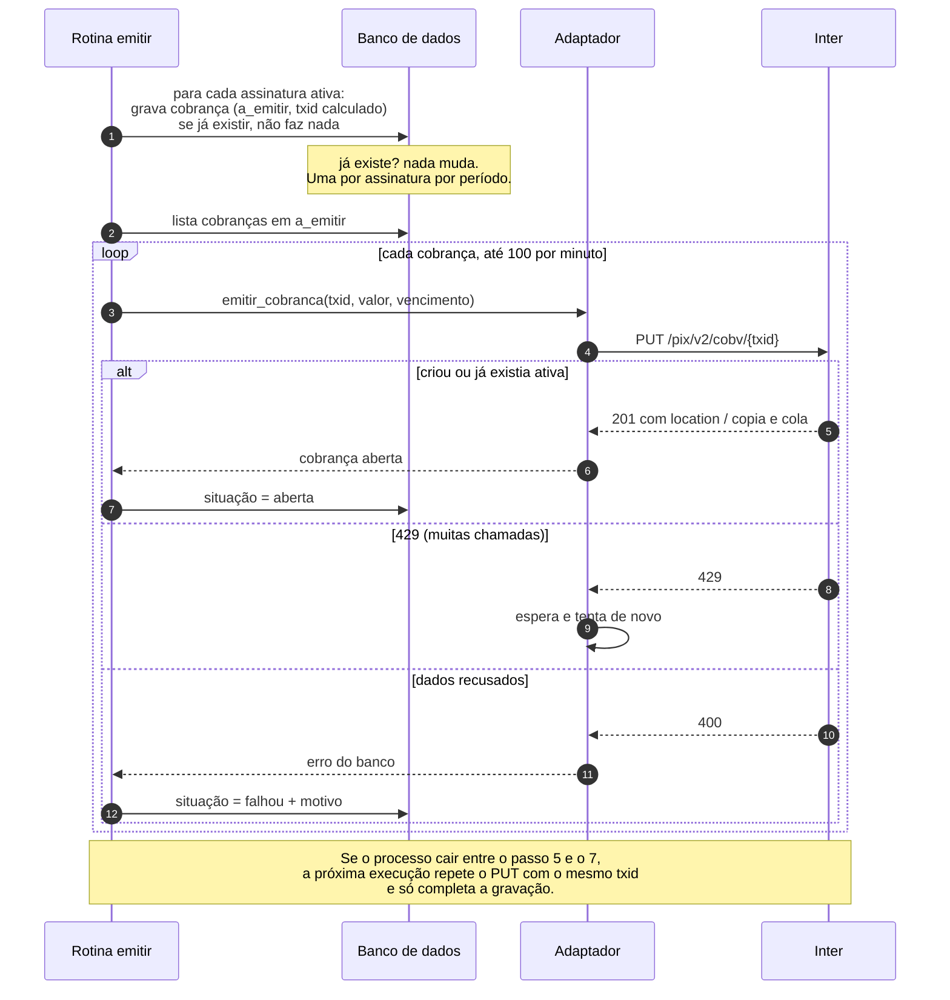
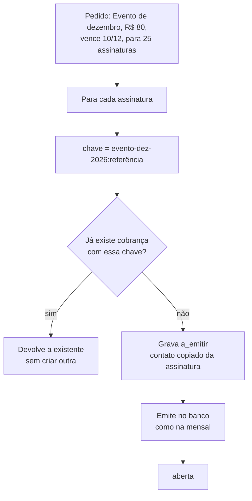
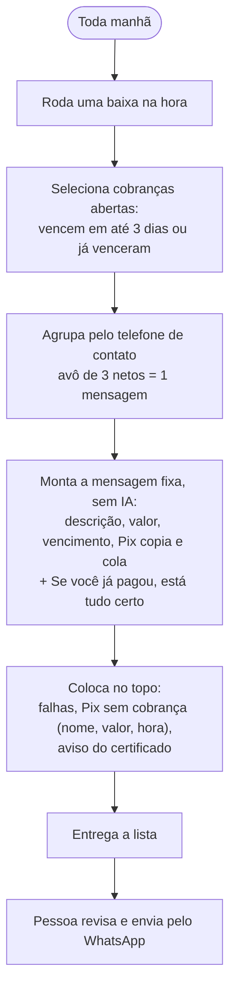
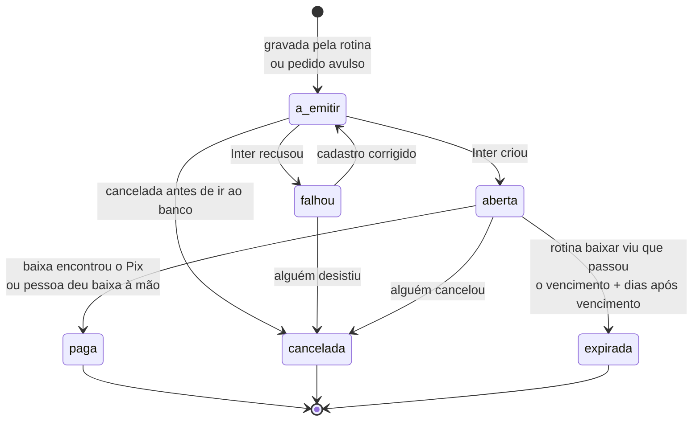
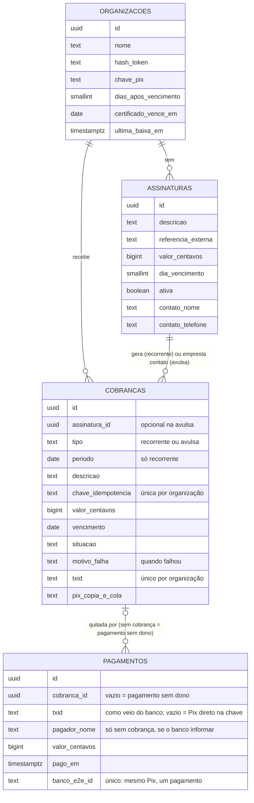
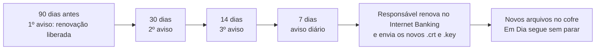

# Processos do Em Dia

Diagramas dos processos combinados antes do código (Pix com vencimento, baixa por consulta periódica, cobranças recorrentes e avulsas, lembretes enviados por uma pessoa). O GitHub renderiza os blocos `mermaid`.


## Mapa de contextos (proposta)

Cinco contextos dentro do Em Dia e três de fora. Cada contexto tem a própria linguagem: o que o sistema do cliente chama de "aluno" ou "plano" o Em Dia chama de "assinatura", e o que o Inter chama de "cobv CONCLUIDA" o Em Dia chama de "cobrança paga". As setas apontam de quem fornece (U, upstream) para quem depende (D, downstream).



- **Cobrança** é o núcleo: decide o que cobrar, de quem e quando, e garante que nada duplica. É onde está o valor do produto.
- **Recebimento** transforma "um Pix chegou" em "esta cobrança está paga". Fica separado porque terá outras fontes depois (webhook, Pix Automático) sem mudar a Cobrança.
- **Integração bancária** é a camada anticorrupção: o formato do Inter não passa daqui. Um banco novo é um adaptador novo.
- **Organizações e acesso** é o kernel compartilhado: todo contexto recebe o contexto autenticado, e nenhum recebe a organização como parâmetro.
- **Lembretes** só lê cobranças. Nunca altera nada nelas e nunca envia mensagens sozinho.
- **Sistema do cliente** fica fora: turmas, chamada e cadastro de alunos não entram no Em Dia. A ligação é a `referencia_externa`. Mais tarde, uma API ou o servidor MCP seria o serviço aberto que o cliente usa.

Na v1, tudo roda num único programa com um banco de dados. Os contextos viram pastas no código (`cobranca/`, `recebimento/`, `bancos/`, `organizacoes/`, `lembretes/`), e um contexto só chama outro pela interface pública dele.


## Visão geral

Três rotinas agendadas falam com o banco só por meio do adaptador. Ninguém de fora chama o Em Dia: sem webhook, não existe servidor público.




## Emissão mensal

Primeiro grava a cobrança no nosso banco, depois pede ao Inter. Como o `txid` é calculado, repetir a rotina sempre cai na mesma cobrança.




## Cobrança avulsa

Taxa de inscrição, material ou qualquer cobrança única. Quem cria informa a chave; pedir de novo com a mesma chave devolve a cobrança que já existe.




## Baixa automática

A cada 15 minutos o Em Dia pergunta ao Inter o que foi pago, só para as organizações que têm cobrança aberta. O intervalo é fixo para manter o banco de dados na camada gratuita do Neon (veja [contexto](contexto.md)). A janela olha uma hora para trás, então um pagamento pode ser visto duas vezes, e isso não faz mal.

As cobranças pagas vêm de `GET /cobv`. Na transição, a rotina também lê `GET /pix` (escopo `pix.read`, temporário) e guarda só os Pix sem `txid`: quem ainda paga direto na chave. Esses ficam como pagamento sem cobrança até uma pessoa ligá-los à cobrança certa na lista do dia. Sem `pix.read`, esse passo é pulado e o resto funciona igual.

```mermaid
sequenceDiagram
  participant J as Rotina baixar
  participant A as Adaptador
  participant I as Inter
  participant D as Banco de dados
  J->>A: listar_pagamentos(desde a última execução - 1h)
  A->>I: GET /cobv concluídas
  I-->>A: pagamentos com txid, valor, endToEndId
  opt pix.read na transição
    A->>I: GET /pix
    I-->>A: Pix recebidos; fica só quem não tem txid
  end
  A-->>J: lista em tipos nossos
  loop cada pagamento
    J->>D: acha cobrança pelo txid
    alt encontrou e valor confere
      J->>D: grava pagamento (único por endToEndId)
      J->>D: situação = paga
    else sem txid, txid desconhecido ou valor diferente
      J->>D: grava pagamento sem cobrança (sem dono), sem baixa
    end
  end
  J->>D: abertas com vencimento + dias após vencimento no passado:<br/>situação = expirada
  Note over J,D: Uma vez por dia a mesma rotina<br/>varre os últimos 7 dias, como rede de segurança.
```


## Lista diária de lembretes

O Em Dia monta a lista e a mensagem; uma pessoa envia. Antes de montar, roda uma baixa extra para não lembrar quem acabou de pagar.



Antes de enviar, a pessoa liga cada Pix sem cobrança à cobrança certa ("dar baixa à mão"), e quem já pagou sai da lista. A mesma ação serve para pagamento em dinheiro.

Onde a lista aparece é decidido no item E0.2 do [roteiro](roteiro.md).


## Ciclo de vida de uma cobrança

As situações são nossas, não as do Inter. "Atrasada" não é uma situação: é uma cobrança aberta com o vencimento no passado.




## Modelo de dados

Quatro tabelas, nenhuma com termos de um cliente específico. Pagamentos que não batem com nenhuma cobrança ficam em `pagamentos` com `cobranca_id` vazio, para o relatório e os alertas. Toda tabela de dados tem `organizacao_id` e é protegida pelo isolamento por organização no próprio banco de dados, com Row Level Security do PostgreSQL.




## Certificado anual

O certificado do Inter vale 1 ano em produção (30 dias no sandbox). A renovação fica liberada 90 dias antes e mantém client id e secret; só troca os arquivos.


